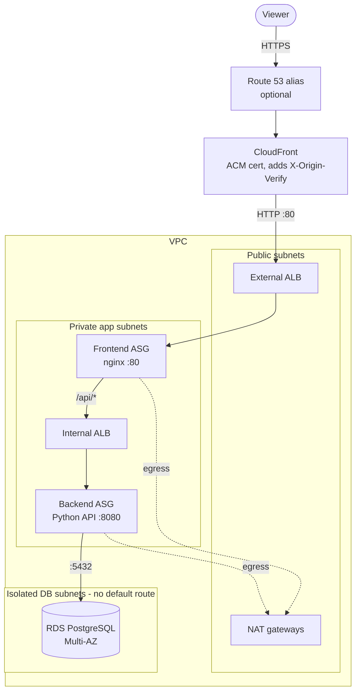

# terraform-aws-high-availability-platform

A three-tier web stack on AWS in `us-east-1`, written in Terraform: CloudFront in front of an external ALB, a frontend Auto Scaling group, an internal ALB, a backend Auto Scaling group, and a Multi-AZ PostgreSQL RDS instance. Everything runs in two Availability Zones by default (three are supported).

**Status:** the configuration passes `terraform validate`, a mocked `terraform test` suite and Checkov. It has **not been planned or applied against AWS**, and the base AMI has not been inspected. [`docs/VALIDATION_REPORT.md`](docs/VALIDATION_REPORT.md) lists exactly what was run.



## Layout

| Path | Purpose |
|---|---|
| `main.tf` | Instantiates the modules |
| `data.tf` | AMI lookup and plan-time checks |
| `security_groups.tf`, `alb.tf` | Security-group chain, both ALBs, target groups, origin-verify secret |
| `modules/network` | VPC, subnets, NAT, route tables, S3 gateway endpoint, flow logs |
| `modules/database` | RDS PostgreSQL, parameter group, log groups, monitoring role |
| `modules/app_tier` | IAM role, launch template, ASG, CPU scaling (used for frontend and backend) |
| `modules/edge` | CloudFront, ACM certificate, Route 53 records |
| `modules/monitoring` | SNS topic and 10 CloudWatch alarms |
| `templates/` | `user_data` for the two tiers |
| `tests/` | `terraform test` suite (mocked provider) |
| `scripts/` | `check_links.py` (broken relative Markdown links) and `check_workflows.py` (workflow policy and event/dependency matrix); both run in CI job 1 |
| `.tflint.hcl` | TFLint config (terraform + AWS rulesets) |
| `docs/` | Architecture, troubleshooting, cost/cleanup, CI setup, publishing checklist, validation record |

## Design notes

**Networking.** Public subnets hold the external ALB and NAT gateways. Application instances sit in private subnets and have no public IPs. Database subnets use a route table with no default route. By default there is one NAT gateway per AZ; `nat_gateway_mode = "single"` uses one shared gateway, which is cheaper but loses all private egress if that AZ fails.

**Security groups.** Each tier accepts traffic only from the one before it: CloudFront prefix list -> external ALB:80 -> frontend:80 -> internal ALB:80 -> backend:8080 -> RDS:5432. There is no SSH or RDP; instances are reached with Session Manager (the instance roles carry `AmazonSSMManagedInstanceCore`, and connectivity goes through the NAT).

**Restricting the origin.** The external ALB's security group admits only CloudFront's origin-facing prefix list. That list is shared by every CloudFront customer, so the listener also returns 403 unless the request carries an `X-Origin-Verify` header whose value is a generated 48-character secret that CloudFront adds. To rotate it: `terraform apply -replace=random_password.origin_verify` (expect a short window of 403s while CloudFront propagates).

**CloudFront caching.** `/` and `/api/*` use the managed `CachingDisabled` policy (nothing dynamic is cached) with `AllViewer` origin requests; `/api/*` allows all HTTP methods. `/static/*` uses `CachingOptimized`. All behaviors redirect HTTP to HTTPS.

**Frontend to backend.** nginx serves a static page and proxies `/api/*` to the internal ALB, re-resolving its DNS name every 30 seconds. Health checks: frontend `/healthz` (answered by nginx), backend `/health` (process liveness only, deliberately independent of the database so a database failover does not drain the tier). `/api/db-health` reports TCP reachability of the database.

**Database.** PostgreSQL 16, Multi-AZ, encrypted, not publicly accessible, `rds.force_ssl=1`, IAM authentication enabled, 7-day backups, deletion protection on by default, CloudWatch log exports and enhanced monitoring. RDS manages the master password in Secrets Manager (`manage_master_user_password`), so it is not in Terraform state, `user_data` or outputs. The backend role may read that one secret; the sample app does not use it yet.

**Scaling.** Both ASGs: min 2 / desired 2 / max 4, ELB health checks, average-CPU target tracking at 50%, rolling instance refresh when the launch template changes. Terraform ignores `desired_capacity` after creation so it does not fight the scaling policy.

**Custom domain (optional).** Set both `domain_name` (`app.example.com`) and `hosted_zone_name` (`example.com`) to get an ACM certificate (DNS-validated) and A/AAAA alias records in an existing public hosted zone. With neither set you get the `*.cloudfront.net` URL.

**State.** Local by default; `*.tfstate` is git-ignored. For shared or CI use, copy `backend.tf.example` to `backend.tf` (S3 backend with native lockfile locking, Terraform >= 1.10). State contains the origin-verify secret, so keep the bucket private, versioned and access-restricted.

### The AMI

`var.ami_id` defaults to `ami-0ed59cbb87dfa8dba`. It could not be inspected when this was written (the available credentials were invalid), so the code does not assume an OS:

- `user_data` picks `dnf`, `yum` or `apt-get` at boot and needs only `bash`, `systemd`, `curl`, `python3` and `nginx`.
- `terraform plan` fails unless the AMI is `available`, `Linux/UNIX`, EBS-backed and `x86_64`/`arm64`, and both instance types support its architecture. The root device name is read from the AMI.
- Once you have checked the owner with `describe-images`, set `ami_owner_id` so the plan also fails if the AMI belongs to a different account.

Check it yourself before planning:

```bash
aws ec2 describe-images --region us-east-1 --image-ids ami-0ed59cbb87dfa8dba \
  --query 'Images[0].[ImageId,Name,Architecture,PlatformDetails,State,OwnerId,RootDeviceName]' --output table
```

If it is `arm64`, set `frontend_instance_type` and `backend_instance_type` to Graviton types such as `t4g.micro`.

## Prerequisites

- Terraform >= 1.10, AWS CLI v2, credentials for the target account
- For a custom domain: an existing public Route 53 hosted zone for it
- The AMI above visible to your account in `us-east-1`

## Usage

```bash
cp terraform.tfvars.example terraform.tfvars   # git-ignored; edit as needed
terraform init
terraform plan
terraform apply          # billable - read docs/COST_AND_CLEANUP.md first
terraform output public_url
```

Then try `/`, `/api/info`, `/api/db-health` and `/static/style.css`.

## Validation

```bash
terraform fmt -check -recursive
terraform init -backend=false -lockfile=readonly && terraform validate
terraform test                                   # mocked provider; no AWS access
tflint --init && tflint --recursive --format compact
checkov -d . --framework terraform --compact --quiet --skip-download
python3 scripts/check_links.py
python3 scripts/check_workflows.py            # needs PyYAML
```

`terraform test` (12 runs, mocked provider, so it proves the Terraform logic and guard rails, not that AWS accepts the resources) checks the HA defaults (two subnets per tier, NAT per AZ, Multi-AZ encrypted private RDS, ASG minimum 2 with ELB health checks, IMDSv2, HTTPS redirect), domain gating, single-NAT mode, and that bad input is rejected (AMI architecture or owner mismatch, engine/parameter-family mismatch, storage ceiling below initial storage, domain without zone, `min = 1`, other regions). Checkov findings that are intentional are suppressed inline with a reason (`grep -rn "checkov:skip" .`).

## CI

| Workflow | Trigger | Purpose |
|---|---|---|
| `terraform.yml` | PR to `main`, push to `main`, manual | **Pull requests:** jobs 1-4 only (repo checks, format, validate/lint/test, Checkov). No AWS access, no plan. **Push to `main`:** jobs 1-4, then 5 plan, then 6 apply of that exact (encrypted, digest-checked) plan if it has changes, after approval on the `lab` Environment. **Manual run:** plan only. Job 7 always summarizes and names the first failing job. |
| `terraform-destroy.yml` | manual | Same gates; lifts deletion protection, then destroys |

Authentication prefers OIDC with separate plan and apply roles (`AWS_PLAN_ROLE_ARN`, `AWS_APPLY_ROLE_ARN`) and falls back to `AWS_ACCESS_KEY_ID` / `AWS_SECRET_ACCESS_KEY` secrets. Pull requests deliberately get no AWS access. The plan file is encrypted with the secret `TF_PLAN_ENCRYPTION_KEY` before it is uploaded. Nothing in CI has been run against AWS yet. Setup, trust policies, the Environment, and why jobs are skipped: [`docs/GITHUB_ACTIONS.md`](docs/GITHUB_ACTIONS.md).

## Troubleshooting and cleanup

- AWS CLI commands per component (AMI, ASG, target groups, ALB rules, CloudFront, ACM, Route 53, RDS, logs): [`docs/TROUBLESHOOTING.md`](docs/TROUBLESHOOTING.md)
- Billable resources and teardown order: [`docs/COST_AND_CLEANUP.md`](docs/COST_AND_CLEANUP.md). In short: lift deletion protection (`db_deletion_protection = false`, `alb_deletion_protection = false`) and apply, then `terraform destroy`.
- Design details and failure behaviour: [`docs/ARCHITECTURE.md`](docs/ARCHITECTURE.md)
- Before pushing to GitHub: [`docs/PUBLISHING_CHECKLIST.md`](docs/PUBLISHING_CHECKLIST.md)

## Known limitations

1. CloudFront -> ALB and ALB -> instance traffic is plain HTTP inside AWS; only the viewer leg is HTTPS. HTTPS to the origin needs a certificate on the ALB for a hostname you own and `origin_protocol_policy = "https-only"`.
2. No WAF, CloudFront/ALB access logs or response-headers policy.
3. Without a custom domain, CloudFront's default certificate cannot enforce a minimum TLS version. With `domain_name` set, `TLSv1.2_2021` is enforced.
4. The CloudFront prefix list counts against the security group's rule quota (about 55 of the default 60 entries); don't add other ingress rules to the external ALB group without a quota increase.
5. No CloudWatch agent on the instances; only default EC2 metrics. Bootstrap output is in `/var/log/app-bootstrap.log`.
6. The alarm SNS topic is not KMS-encrypted (CloudWatch alarms cannot publish to the AWS-managed SNS key).
7. The sample apps demonstrate routing and health checks; they are not a real application.
8. Single account, single region.

## License

Apache License 2.0. See [`LICENSE`](LICENSE).
