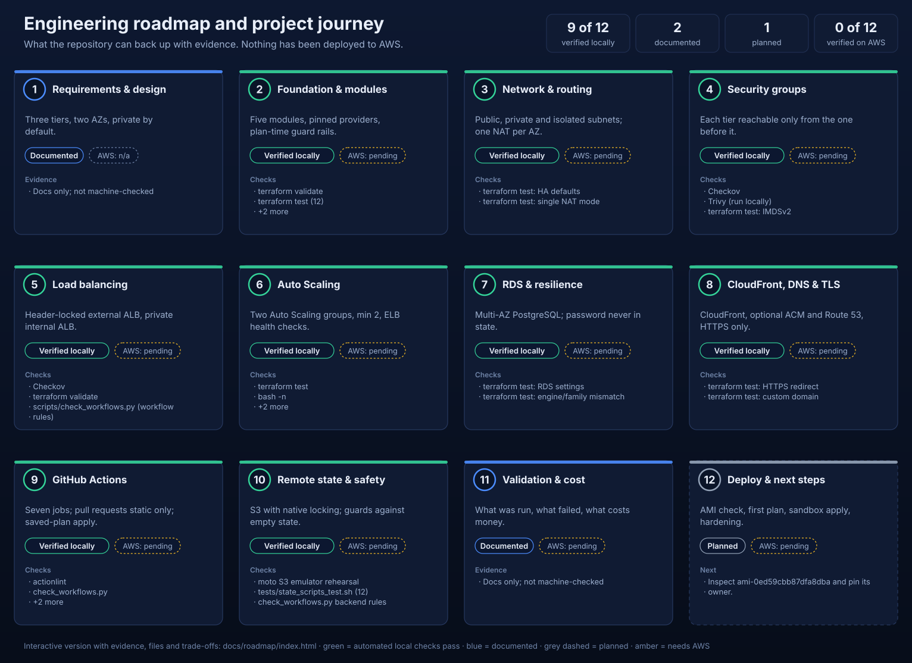

<!-- Generated by scripts/build_visuals.py from docs/roadmap/roadmap.json. Edit the JSON, then re-run the script. -->
# Roadmap

Milestones of this project and the evidence behind each status. **Nothing has been deployed to AWS**, and AWS credentials were invalid throughout, so no stage is verified on AWS.

**9 of 12** stages are verified locally, **2** are documented, **1** is planned, and **0 of 12** are verified on AWS. These are counts, not a completion percentage.

Interactive version: open [`roadmap/index.html`](roadmap/index.html) in a browser after cloning (GitHub's file view shows the source, not the page).

| Stage | Status | AWS verification |
|---|---|---|
| 1. Requirements & architecture design | Documented | not applicable |
| 2. Terraform foundation & module structure | Verified locally | pending |
| 3. Network segmentation & routing | Verified locally | pending |
| 4. Security groups & traffic restrictions | Verified locally | pending |
| 5. External & internal load balancing | Verified locally | pending |
| 6. Frontend & backend Auto Scaling | Verified locally | pending |
| 7. RDS PostgreSQL & database resilience | Verified locally | pending |
| 8. CloudFront, Route 53 & TLS | Verified locally | pending |
| 9. GitHub Actions & automated checks | Verified locally | pending |
| 10. Remote state & deployment safety | Verified locally | pending |
| 11. Validation, troubleshooting & cost review | Documented | pending |
| 12. Deployment verification & future improvements | Planned | pending |

**Status key.** *Verified locally*: automated checks pass on this machine (static analysis, mocked tests, local emulators). *Documented*: written and reviewed, not exercised by an automated check. *Planned*: not started. *AWS: pending*: needs a working AWS account.

## 1. Requirements & architecture design

**Documented** · AWS: na

A three-tier web platform in us-east-1: CloudFront in front of an external ALB, a frontend tier, an internal ALB, a backend tier and a Multi-AZ PostgreSQL database, spread across two Availability Zones.

Evidence:

- Traffic paths, subnet plan, security-group matrix and failure analysis are written down in docs/ARCHITECTURE.md.
- The mandated AMI is a configurable input whose default never changes.

Decisions and trade-offs:

- Two AZs by default (three supported): the cheapest layout that survives the loss of one zone.
- Private application subnets and isolated database subnets, so no instance has a public IP.
- CloudFront in front of the ALB so the internet-facing load balancer is not the public entry point.

Limits:

- No requirements document beyond the original brief; the design is the specification.

Files:

- [`docs/ARCHITECTURE.md`](../docs/ARCHITECTURE.md) — Architecture and traffic paths
- [`README.md`](../README.md) — Design notes and known limitations

## 2. Terraform foundation & module structure

**Verified locally** · AWS: pending

Five modules (network, database, app_tier, edge, monitoring) composed by a small root. Provider versions pinned, lock file covers five platforms, plan-time guard rails reject bad input early.

Evidence:

- terraform fmt, init, validate pass; the lock file holds hashes for linux, macOS and Windows.
- terraform test: 12 runs against a mocked provider pass.
- TFLint (Terraform and AWS rulesets) reports nothing; Checkov: 235 passed, 0 failed, 32 skipped with written reasons.

Checks:

- terraform validate
- terraform test (12)
- TFLint
- Checkov

Decisions and trade-offs:

- Cross-tier wiring (security groups, load balancers) stays in the root; modules own one concern each.
- The AMI must be available, Linux, EBS-backed and architecture-compatible, or the plan fails before anything is created.
- Suppressions sit next to the code with a reason, so every accepted scanner finding is reviewable.

Limits:

- Mocked tests prove logic and guard rails, not that AWS accepts every argument.
- The configuration has never been planned: AWS credentials were invalid throughout.

Files:

- [`main.tf`](../main.tf) — Composition root
- [`data.tf`](../data.tf) — AMI lookup and plan-time preconditions
- [`versions.tf`](../versions.tf) — Provider and Terraform constraints
- [`tests/ha.tftest.hcl`](../tests/ha.tftest.hcl) — Mocked test suite
- [`.terraform.lock.hcl`](../.terraform.lock.hcl) — Provider lock file

## 3. Network segmentation & routing

**Verified locally** · AWS: pending

A /16 VPC with public, private-application and isolated-database subnets per AZ, an Internet Gateway, one NAT gateway per AZ (or one shared), per-AZ private route tables and an S3 gateway endpoint.

Evidence:

- Mocked tests assert two subnets per tier, one NAT per AZ by default, a single NAT in the cost-saving mode, and no auto-assigned public IPs.
- The database route table carries only the local route.

Checks:

- terraform test: HA defaults
- terraform test: single NAT mode

Decisions and trade-offs:

- A NAT gateway per AZ keeps egress alive when a zone fails but roughly doubles the hourly NAT cost; a single NAT is offered and documented as less resilient.
- A free S3 gateway endpoint keeps S3-bound traffic off the NAT.

Limits:

- Routing correctness is asserted structurally; no packet has crossed this network.

Files:

- [`modules/network/main.tf`](../modules/network/main.tf) — VPC, subnets, NAT, routes, flow logs
- [`variables.tf`](../variables.tf) — az_count and nat_gateway_mode

## 4. Security groups & traffic restrictions

**Verified locally** · AWS: pending

Each tier accepts traffic only from the tier before it: CloudFront prefix list, external ALB, frontend, internal ALB, backend, database. No SSH or RDP; Session Manager for access. IMDSv2 required.

Evidence:

- Checkov and Trivy results are reviewed; every remaining finding is an accepted, documented decision.
- IMDSv2 enforcement is asserted by the mocked tests.

Checks:

- Checkov
- Trivy (run locally)
- terraform test: IMDSv2

Decisions and trade-offs:

- Rules reference security groups, not CIDR ranges, so the chain still holds when instances are replaced.
- The backend role may read only the RDS-managed secret; the frontend role reads none.

Limits:

- The unit tests do not assert individual security-group rules; they are covered by review and static scanning.
- Ports 80 and 443 to the internet remain open for package installs and Session Manager via NAT.

Files:

- [`security_groups.tf`](../security_groups.tf) — Security-group chain
- [`modules/app_tier/main.tf`](../modules/app_tier/main.tf) — Instance roles and launch template

## 5. External & internal load balancing

**Verified locally** · AWS: pending

An internet-facing ALB that answers 403 unless a secret header from CloudFront is present, and a private internal ALB between the tiers. Health checks use dedicated endpoints.

Evidence:

- The listener's default action is a fixed 403; only the header rule forwards to the frontend target group.
- Frontend health check /healthz is served by nginx; backend /health is liveness only, independent of the database.

Checks:

- Checkov
- terraform validate
- scripts/check_workflows.py (workflow rules)

Decisions and trade-offs:

- Two layers restrict the origin: the CloudFront prefix list in the security group and a high-entropy header. The prefix list alone is shared by every CloudFront customer.
- The backend health check ignores the database so a database failover does not drain the whole tier.

Limits:

- CloudFront to ALB and ALB to instances use HTTP; only the viewer leg is HTTPS.
- No WAF and no ALB access logs.

Files:

- [`alb.tf`](../alb.tf) — ALBs, target groups, listeners, origin-verify secret
- [`templates/frontend_user_data.sh.tftpl`](../templates/frontend_user_data.sh.tftpl) — nginx proxy to the internal ALB

## 6. Frontend & backend Auto Scaling

**Verified locally** · AWS: pending

Two Auto Scaling groups (min 2, desired 2, max 4) using ELB health checks and CPU target tracking, built from launch templates with encrypted root volumes. Bootstrap detects dnf, yum or apt.

Evidence:

- Mocked tests assert minimum capacity 2, ELB health checks, the mandated AMI and IMDSv2.
- Both rendered bootstrap scripts pass bash -n and shellcheck; the backend Python app compiles.

Checks:

- terraform test
- bash -n
- shellcheck
- py_compile

Decisions and trade-offs:

- The AMI's operating system was never inspected, so the scripts choose the package manager at boot and the plan verifies architecture compatibility.
- Line endings are forced to LF so a Windows checkout cannot break the bootstrap.

Limits:

- The bootstrap has never run on an instance. Syntax checks do not prove the services start.
- The AMI ami-0ed59cbb87dfa8dba has not been inspected.

Files:

- [`modules/app_tier/main.tf`](../modules/app_tier/main.tf) — Launch template, ASG, scaling policy
- [`templates/backend_user_data.sh.tftpl`](../templates/backend_user_data.sh.tftpl) — Backend bootstrap
- [`data.tf`](../data.tf) — AMI and instance-type preconditions

## 7. RDS PostgreSQL & database resilience

**Verified locally** · AWS: pending

PostgreSQL 16, Multi-AZ, encrypted, private, forced SSL, 7-day backups, deletion protection on by default. RDS manages the master password in Secrets Manager.

Evidence:

- Mocked tests assert Multi-AZ, encryption, no public access and backups.
- Plan-time preconditions reject an engine/parameter-family mismatch and a storage ceiling below the initial storage.

Checks:

- terraform test: RDS settings
- terraform test: engine/family mismatch

Decisions and trade-offs:

- manage_master_user_password keeps the password out of Terraform state, user_data and outputs.
- RDS log groups are created first so the retention setting applies.

Limits:

- db.t3.micro with PostgreSQL 16 and Multi-AZ is not yet confirmed as an orderable combination.
- The fixed final-snapshot name collides on a second destroy while the first snapshot exists.

Files:

- [`modules/database/main.tf`](../modules/database/main.tf) — Instance, parameter group, log groups
- [`data.tf`](../data.tf) — Database preconditions

## 8. CloudFront, Route 53 & TLS

**Verified locally** · AWS: pending

A CloudFront distribution with three cache behaviors, an optional DNS-validated ACM certificate and Route 53 alias records. HTTP redirects to HTTPS; API and HTML are never cached.

Evidence:

- Mocked tests assert the HTTPS redirect, and that ACM plus A and AAAA records exist only when a domain and zone are both set.

Checks:

- terraform test: HTTPS redirect
- terraform test: custom domain

Decisions and trade-offs:

- /static/* is cached; / and /api/* use the managed caching-disabled policy.
- Without a custom domain the default CloudFront certificate is used, which cannot enforce a minimum TLS version.

Limits:

- No domain has been configured, so certificate validation and the alias records are untested.
- No WAF, access logging or response-headers policy.

Files:

- [`modules/edge/main.tf`](../modules/edge/main.tf) — CloudFront, ACM, Route 53

## 9. GitHub Actions & automated checks

**Verified locally** · AWS: pending

Seven separate jobs: repository checks, format, validate and test, Checkov, plan, apply of the saved plan, and a summary that names the first failure. Pull requests run static checks only.

**Observed on GitHub:** Observed on GitHub (run and job records). Commit 7d13de0: jobs 1-4 passed and job 5 failed at its configuration check because the state bucket variable was not set. Commit 2ada9cc: job 3 failed at the step "Provider versions" because terraform providers needs an initialised backend and the job runs init with -backend=false; re-running that run failed identically, because a re-run uses the workflow file of the original commit. Commit 60c0db5 removed the step: jobs 1-4 passed. Job 5 still fails at the state-bucket check by design. No plan or apply has run.

Evidence:

- check_workflows.py asserts the policy and simulates GitHub's needs/if semantics over 2,880 event, branch and failure combinations; seven deliberate breakages are all rejected.
- actionlint with shellcheck passes; every action is pinned to a verified commit SHA.
- The encrypt, digest and verify logic of the plan hand-off was exercised locally with OpenSSL.

Checks:

- actionlint
- check_workflows.py
- mutation tests
- plan hand-off test

Decisions and trade-offs:

- Pull requests get no AWS access: under OIDC the pull request's own workflow file runs, so a PR plan would expose credentials to any branch.
- The plan file can contain secrets and artifacts of a public repository are downloadable, so it is encrypted before upload and apply checks its digest.

Limits:

- OIDC providers, roles, secrets and the lab Environment are not configured; no AWS authentication has been tested.
- A public repository exposes job logs to everyone.

Files:

- [`.github/workflows/terraform.yml`](../.github/workflows/terraform.yml) — CI workflow
- [`.github/workflows/terraform-destroy.yml`](../.github/workflows/terraform-destroy.yml) — Manual destroy workflow
- [`scripts/check_workflows.py`](../scripts/check_workflows.py) — Policy and event-matrix test
- [`docs/GITHUB_ACTIONS.md`](../docs/GITHUB_ACTIONS.md) — Trust model and setup

## 10. Remote state & deployment safety

**Verified locally** · AWS: pending

S3 backend with native lockfile locking, committed as a partial configuration. One shared action initialises it, checks the bucket, and refuses to plan an empty state when this stack's infrastructure already exists.

Evidence:

- Migration of existing local state into the S3 backend, lock contention and stale-lock recovery were rehearsed against a local S3 emulator.
- The guard scripts pass 12 fake-CLI cases and every outcome against the emulator, including failing closed.
- The S3 permissions needed per Terraform operation were read from the emulator's request log.

Checks:

- moto S3 emulator rehearsal
- tests/state_scripts_test.sh (12)
- check_workflows.py backend rules

Decisions and trade-offs:

- Native S3 locking (Terraform 1.10 and later) instead of the deprecated DynamoDB table.
- The plan role only reads state; only apply and destroy may write it.

Limits:

- No bucket exists and no state was migrated. The emulator is not real S3.
- The existing-infrastructure guard is a heuristic: it cannot see CloudFront, DNS records or alarms.

Files:

- [`backend.tf`](../backend.tf) — Partial S3 backend
- [`.github/actions/terraform-backend/action.yml`](../.github/actions/terraform-backend/action.yml) — Shared init and guards
- [`docs/REMOTE_STATE.md`](../docs/REMOTE_STATE.md) — Bucket, IAM, migration, recovery
- [`scripts/check_state_vs_infra.sh`](../scripts/check_state_vs_infra.sh) — Empty-state guard

## 11. Validation, troubleshooting & cost review

**Documented** · AWS: pending

A validation record of every command actually run, per-component troubleshooting commands, and a cost and teardown guide with the billable resources listed.

Evidence:

- docs/VALIDATION_REPORT.md separates verified facts from what needs credentials and lists defects found along the way.
- The troubleshooting commands and cost figures have not been run or queried against AWS; the figures are estimates.

Decisions and trade-offs:

- Reports record failures and false alarms, not only passes.

Limits:

- Expect roughly 150 to 250 US dollars per month if left running with the defaults (an estimate, not a quote).

Files:

- [`docs/VALIDATION_REPORT.md`](../docs/VALIDATION_REPORT.md) — What was run, and what was not
- [`docs/TROUBLESHOOTING.md`](../docs/TROUBLESHOOTING.md) — AWS CLI debugging commands
- [`docs/COST_AND_CLEANUP.md`](../docs/COST_AND_CLEANUP.md) — Billable resources and teardown

## 12. Deployment verification & future improvements

**Planned** · AWS: pending

Not started: confirm the AMI, create the state bucket, plan, apply to a sandbox account and verify the platform end to end. Then harden: HTTPS to the origin, WAF, access logs, request-based scaling.

Limits:

- Everything on this stage requires AWS credentials that work.

Next:

- Inspect ami-0ed59cbb87dfa8dba and pin its owner.
- Create the state bucket, the OIDC roles and the lab Environment.
- Plan, review, apply once in a sandbox account, then verify and tear down.
- HTTPS between CloudFront and the ALB, WAF, access logs, request-count scaling, CloudWatch agent.

Files:

- [`docs/PUBLISHING_CHECKLIST.md`](../docs/PUBLISHING_CHECKLIST.md) — Checks to run with working credentials
